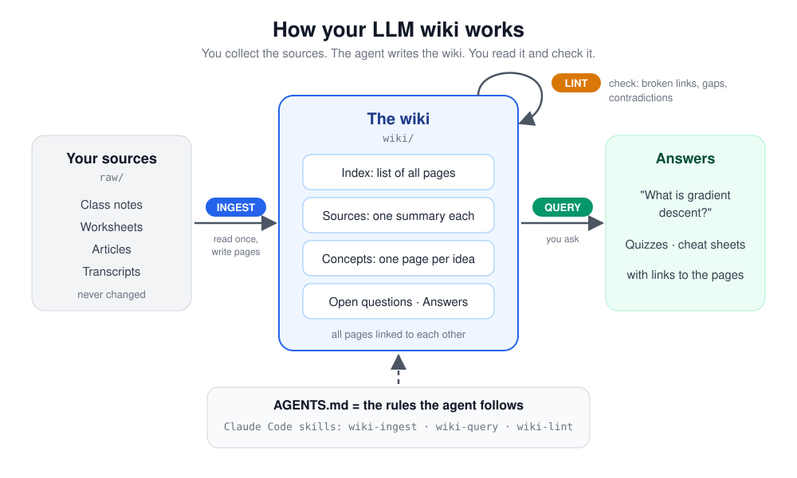

# IAT AI Knowledgebase — build your own LLM wiki

Imagine a study notebook that writes itself. You collect your sources: class notes, worksheets, articles. An AI
agent reads them and turns them into a tidy little wiki, with one page per idea, links between the pages, and a
list of things that are still unclear. When you add a new source, the wiki gets better. When you have a test, you
ask it questions.

This is called an **LLM wiki**. The idea comes from Andrej Karpathy, a well-known AI researcher, who described it in
his [LLM Wiki](https://gist.github.com/karpathy/442a6bf555914893e9891c11519de94f) notes. This repository is a small,
working version of it for the [IAT Coding Lab](../README.md). It is your starting point for the lab project.

> "You read it; the LLM writes it." — Andrej Karpathy

## How it works



There are **three layers**:

| Layer | Folder | Who writes it |
|---|---|---|
| **Sources** | [`raw/`](raw/README.md) | You. The agent reads them, but never changes them. |
| **Wiki** | [`wiki/`](wiki/index.md) | The agent. You read it and correct it. Start at [`wiki/index.md`](wiki/index.md). |
| **Rules** | [`AGENTS.md`](AGENTS.md) | You and the agent together. What pages look like, and how each job works. |

And **three jobs** the agent does. Each one is a Claude Code *skill*, a short instruction file in
[`.claude/skills/`](.claude/skills/):

| Job | What it does | Say to Claude |
|---|---|---|
| **Ingest** | Reads one new source, writes a summary, creates or updates the concept pages | "ingest raw/biology-cells.md" |
| **Query** | Answers a question from the wiki, with links to the pages it used | "what does the wiki say about gradient descent?" |
| **Lint** | Checks the wiki: broken links, missing pages, contradictions | "lint the wiki" |

### Why not just ask a chatbot?

A chatbot starts from zero every time you ask. It doesn't remember your sources, and you can't see where its answer
comes from. In an LLM wiki the agent reads each source **once** and writes down what it learned. Everything is plain
text that you can read, check and fix. Every page says which source it comes from, so you can see when the agent
added something on its own.

## Try it: the example wiki

The wiki in this repository is already filled with an example topic: **how neural networks learn**. It was built
from two sources about the lab's neural-network lesson, [`IAT-nns-for-students`](../IAT-nns-for-students/): the
text of the notebook (in German) and its README. From these, the agent wrote five concept pages in English, from
[linear regression](wiki/concepts/linear-regression.md) to [neural networks](wiki/concepts/neural-network.md).

It also found two places where the sources disagree, and wrote them down as
[open questions](wiki/open-questions.md) instead of guessing. That is exactly what a good wiki should do.

So the wiki explains how a neural network learns, and it was written by a very large neural network.

## Quick start

You need [Git](https://git-scm.com/), [VS Code](https://code.visualstudio.com/) and
[Claude Code](https://docs.claude.com/en/docs/claude-code/overview). That's all: no Python packages, no database.

1. Open this folder (`IAT-ai-knowledgebase`) in VS Code: **File → Open Folder**.
2. Open a terminal in VS Code (**Terminal → New Terminal**) and check the wiki:
   ```bash
   bash scripts/lint.sh
   ```
   It should end with `Result: 0 error(s), 0 warning(s)`. On Windows, use the Git Bash terminal.
3. Start Claude Code:
   ```bash
   claude
   ```
4. Ask your first question:
   ```text
   What does the wiki say about loss functions? Explain it in three sentences.
   ```
5. Add your own source. Save your notes as a file in `raw/`, for example `raw/2026-11-20-physics-motion.md`. Then:
   ```text
   ingest raw/2026-11-20-physics-motion.md
   ```

Then work through the [exercises](exercises/README.md), step by step.

**Tips**

- To read this README with the picture in VS Code, open the preview: `Cmd+Shift+V` on macOS, `Ctrl+Shift+V` on
  Windows.
- Open the folder in [Obsidian](https://obsidian.md) as well. Its graph view shows how your pages are linked, like a
  map of your knowledge.

## What's inside

```
IAT-ai-knowledgebase/
├── README.md          # This file
├── AGENTS.md          # The rules for the agent (CLAUDE.md just points here)
├── CLAUDE.md
├── raw/               # Your sources. Two examples are already here
├── wiki/
│   ├── index.md       # List of all pages: start here
│   ├── log.md         # Diary: what was added, asked and checked, and when
│   ├── open-questions.md
│   ├── sources/       # One summary per source
│   ├── concepts/      # One page per idea
│   └── answers/       # Good answers, saved for later
├── templates/         # What a source, concept or answer page looks like
├── assets/            # The overview picture in this README
├── scripts/lint.sh    # The automatic part of the health check
├── exercises/         # Step-by-step tasks for the lab
└── .claude/skills/    # The three skills: wiki-ingest, wiki-query, wiki-lint
```

## Make it your own

The neural-network pages are just an example. For your project, pick a subject you have at school and build your
wiki for it. Some ideas to go further:

- **Your own skill:** a quiz maker, a cheat-sheet maker before a test, or flashcards. See
  [exercise 7](exercises/README.md#7-write-your-own-skill-45-min).
- **New page types:** `people/` for history, `formulas/` for physics, `vocabulary/` for languages. Change
  `AGENTS.md` and add a template.
- **More checks:** teach `scripts/lint.sh` something new, for example "every concept page has at least two links".

## Stay safe and stay honest

- Only put material into `raw/` that you are allowed to share. No private information about other people: no phone
  numbers, addresses, grades or health information.
- The agent can be wrong. Read what it writes and correct it. That is part of learning.
- The wiki helps you learn. It doesn't replace your own work: if your teacher asks for your own text, write it
  yourself.

## Want to read more?

- Andrej Karpathy: [LLM Wiki](https://gist.github.com/karpathy/442a6bf555914893e9891c11519de94f), the original
  idea (April 2026). It is written to be pasted to an AI agent, which then builds the details with you.
- [Claude Code skills](https://docs.claude.com/en/docs/claude-code/skills): how the skills in `.claude/skills/`
  work.
- [AGENTS.md](https://agents.md/): a common way to write instructions for coding agents.
