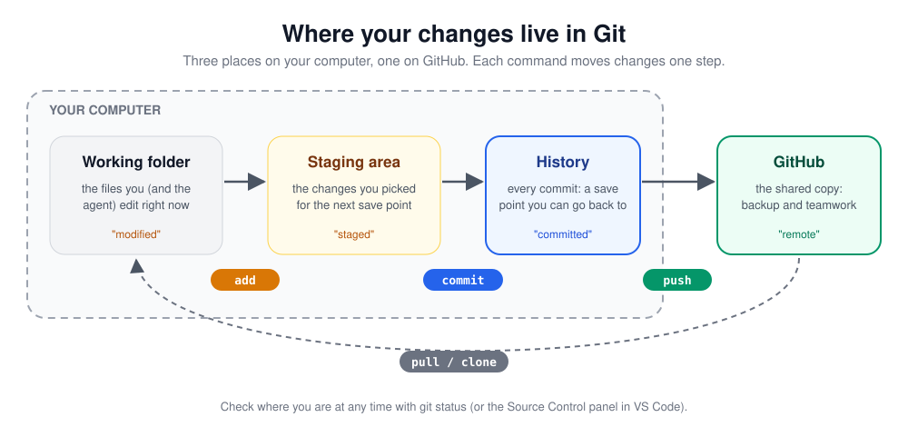

# IAT Coding Lab 2026

Materials for the **Coding Lab** at the Internationale Akademie Traunkirchen (IAT): a project-based program in
English, for high school students, about AI and programming / software engineering. Students go from first
principles (how does a neural network learn?) to a working AI-assisted software project of their own, with the tools
professionals use: Claude Code, Git, Python and VS Code.

The full plan is in the [curriculum](Coding_Lab_Curriculum_2026_v0.9.1.pdf). To change it, edit
[`curriculum/build_curriculum.py`](curriculum/build_curriculum.py), bump `VERSION` and run
`python3 curriculum/build_curriculum.py` (needs ReportLab).

## Projects

| Folder | What it is | Used in |
|---|---|---|
| [`IAT-nns-for-students/`](IAT-nns-for-students/README.md) | Neural networks from scratch: a Jupyter notebook from a straight line to gradient descent, `micrograd` and a small neural network, plus an MNIST script in PyTorch | Session 1: "neural networks → tokens → today's AI coding tools" |
| [`IAT-ai-knowledgebase/`](IAT-ai-knowledgebase/README.md) | A simple **LLM wiki** (after Andrej Karpathy): Claude Code turns your sources into linked Markdown pages, answers questions from them and checks them. The starting point for the lab project | Sessions 2–4: project setup, lab block, architecture |

The two projects are connected: the example wiki in `IAT-ai-knowledgebase` was built from the notebook in
`IAT-nns-for-students`. So the wiki explains, in its own pages, how the kind of model that maintains it learns.

## The program

| Session | Topic | Projects |
|---|---|---|
| 0 | Overview, demo and housekeeping: Claude Code setup, ground rules | Demo of both |
| 1 | Git, Python and code agents: command line, what a coding agent is, from neural networks to tokens | `IAT-nns-for-students` |
| 2 | Project repository setup: clone, write a README with Claude Code, find a starter dataset (school work), define at least one knowledge-base skill | `IAT-ai-knowledgebase`, [exercises 1–6](IAT-ai-knowledgebase/exercises/README.md) |
| 3 | Lab block (up to 5 sessions): build sprints, knowledge sharing, mini-presentations | Your own wiki and skills, exercises 7–8 |
| 4 | Architecture, extensions and learning paths: knowledge graphs, Open Knowledge Format, how teams work | Exercise discussion questions |
| 5 | Stories, epics and closing: Scrum, wrap-up, using the tools for school | Your project |

Each session also has a reading from the course paper. See [Required reading](#required-reading) below.

## Getting started

Do this once, before or during session 0. It takes about 30 minutes. New to the terminal or Git? Read
[Basics: the terminal, Git and your code editor](reading/basics-terminal-git-editor.md) first.

### 1. Accounts

- **GitHub:** create a free account at [github.com](https://github.com/signup). Your projects will live there.
- **Claude:** you get access to Claude Code in session 0. You log in the first time you start it.

### 2. Install the tools

| Tool | What for | How to install |
|---|---|---|
| **Git** | Saving and sharing your work | Windows: [git-scm.com](https://git-scm.com/downloads) (also installs **Git Bash**, a terminal). macOS: run `xcode-select --install` in Terminal |
| **A code editor** | Reading and checking code | We recommend **[VS Code](https://code.visualstudio.com/)**: its built-in terminal and Git panel keep Claude Code, your files and your changes in one window. Any editor works, though. [Why VS Code?](reading/basics-terminal-git-editor.md#3-your-code-editor) |
| **Claude Code** | Your coding agent | See below |
| **Python 3.10+** | Only for `IAT-nns-for-students` | [python.org](https://www.python.org/downloads/), or skip it and use the [dev container](#5-optional-a-ready-made-environment-dev-container) |

Install Claude Code from a terminal. On macOS or Linux:

```bash
curl -fsSL https://claude.ai/install.sh | bash
```

On Windows (PowerShell):

```powershell
irm https://claude.ai/install.ps1 | iex
```

If one of these doesn't work, follow the current instructions in the
[Claude Code docs](https://docs.claude.com/en/docs/claude-code/setup).

Then close the terminal, open a new one, and check that everything is there:

```bash
git --version
claude --version
code --version
```

`code` is VS Code's command. If it's missing on a Mac, open VS Code, press `Cmd+Shift+P` and run
**Shell Command: Install 'code' command in PATH**.

### 3. Get your own copy of the lab

You can't push to this repository, but you can make your own copy:

1. On GitHub, click **Fork** (top right of this page). This creates `github.com/<your-name>/IAT-code-lab`.
2. Clone **your fork** into a folder of your choice:

   ```bash
   git clone https://github.com/<your-name>/IAT-code-lab.git
   cd IAT-code-lab
   ```

3. Tell Git who you are (once per computer):

   ```bash
   git config --global user.name "Your Name"
   git config --global user.email "you@example.com"
   ```

### 4. Open a project and start Claude Code

1. In VS Code: **File → Open Folder** and choose a **project folder**, e.g. `IAT-code-lab/IAT-ai-knowledgebase`.
   Open the project, not the whole lab folder: then the terminal, Git and Claude Code all start in the right place.
   If VS Code asks whether you trust the folder, say yes.
2. Open the terminal with `` Ctrl+` `` and start the agent:

   ```bash
   claude
   ```

3. Try a first task:

   ```text
   What is this project about? Explain it in three sentences.
   ```

4. Follow the project's README: start with [`IAT-nns-for-students`](IAT-nns-for-students/README.md) in session 1 and
   [`IAT-ai-knowledgebase`](IAT-ai-knowledgebase/README.md) from session 2.

### 5. Optional: a ready-made environment (dev container)

`IAT-nns-for-students` needs Python packages and Graphviz. Instead of installing them yourself, you can open it in a
**dev container**: a ready-made Linux environment with everything installed, the same on every computer.

- **On your computer:** install [Docker Desktop](https://www.docker.com/products/docker-desktop/) and the VS Code
  extension **Dev Containers**. Open the `IAT-nns-for-students` folder, then press `Ctrl+Shift+P` /
  `Cmd+Shift+P` and run **Dev Containers: Reopen in Container**. The first start takes a few minutes.
- **In the browser, without installing anything:** on GitHub, open your fork and click **Code → Codespaces → Create
  codespace**. Choose the configuration **IAT neural networks**. GitHub gives free monthly hours to personal
  accounts.

### Stuck?

| Problem | Try this |
|---|---|
| `command not found` right after installing | Close the terminal and open a new one. On Windows, restart VS Code |
| `git push` says permission denied | You cloned the course repository, not your fork. Fork it, then `git remote set-url origin https://github.com/<your-name>/IAT-code-lab.git` |
| Claude Code asks you to log in again | Run `claude` and follow the login link |
| Something else | Copy the error message and ask Claude Code, or ask in the lab group |

## Required reading

| Read | When | What it covers |
|---|---|---|
| [Basics: the terminal, Git and your code editor](reading/basics-terminal-git-editor.md) | Before session 1 | Commands you need, Git's save points and how to undo, why VS Code (integrated terminal, Git panel) |
| [How coding agents work](reading/coding-agents.md) | Before session 1, then each session | The course paper, with a reading map, diagrams and what it means for you |

[](reading/basics-terminal-git-editor.md)

**[Basics: the terminal, Git and your code editor](reading/basics-terminal-git-editor.md)**: the three tools you
use in every session. Paths and the ten commands you need, Git explained as save points (commit, push, pull, undo),
and how Git protects you when an agent edits your files. It also explains why we recommend VS Code: its integrated
terminal runs Claude Code next to your files, and its Source Control panel shows every change the agent makes as a
colored diff that you can stage, discard or commit with one click.

**[How coding agents work](reading/coding-agents.md)**: a guide to the course paper, *Dive into Claude Code: The
Design Space of Today's and Future AI Agent Systems* (Liu et al., 2026,
[arXiv:2604.14228](https://arxiv.org/abs/2604.14228)).

[](reading/coding-agents.md)

The guide has:

- **A reading map:** which sections of the paper to read for each session.
- **A summary with diagrams:** the agent loop, the harness around the model, permission modes, context and memory,
  extensions, and the six open questions for future agents.
- **A take from a coding agent itself:** what it's like inside the loop, and what's new in the field.
- **What it means for you:** why understanding, clear writing and checking matter more than ever, and things to
  try this week.

Read it before session 1, and come back to it each session.
