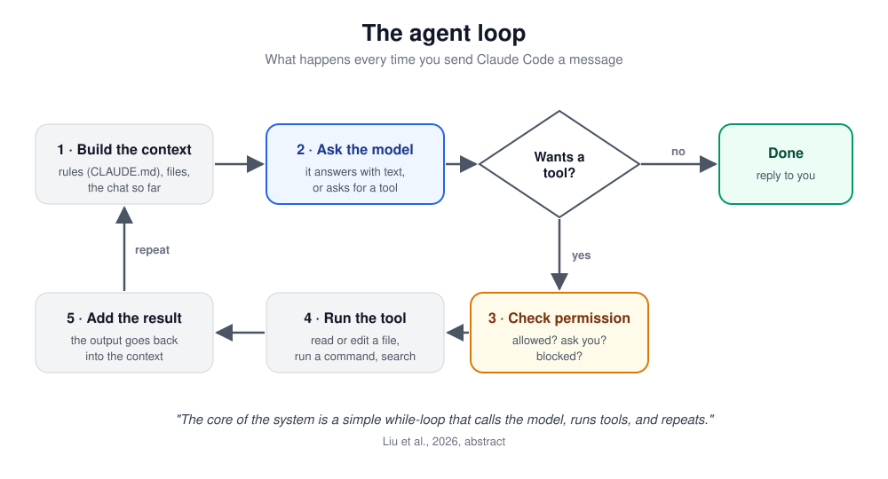

# IAT Coding Lab 2026

Materials for the **Coding Lab** at the Internationale Akademie Traunkirchen (IAT): a project-based programme in
English, for high school students, about AI and programming / software engineering. Students go from first
principles (how does a neural network learn?) to a working AI-assisted software project of their own, with the tools
professionals use: Claude Code, Git, Python and VS Code.

The full plan is in the [curriculum](Coding_Lab_Curriculum_2026_v0.9.1.pdf). To change it, edit
[`curriculum/build_curriculum.py`](curriculum/build_curriculum.py), bump `VERSION` and run
`python3 curriculum/build_curriculum.py` (needs ReportLab).

## Projects

| Folder | What it is | Used in |
|---|---|---|
| [`IAT-nns-for-students/`](IAT-nns-for-students/README.md) | Neural networks from scratch: a Jupyter notebook from a straight line to gradient descent, `micrograd` and a small neural network, plus an MNIST script in PyTorch | Session 1: "neural networks → tokens → today's AI coding tools" |
| [`IAT-ai-knowledgebase/`](IAT-ai-knowledgebase/README.md) | A simple **LLM wiki** (after Andrej Karpathy): Claude Code turns your sources into linked Markdown pages, answers questions from them and checks them. The starting point for the lab project | Sessions 2–4: project setup, lab block, architecture |

The two projects are connected: the example wiki in `IAT-ai-knowledgebase` was built from the notebook in
`IAT-nns-for-students`. So the wiki explains, in its own pages, how the kind of model that maintains it learns.

## The programme

| Session | Topic | Projects |
|---|---|---|
| 0 | Overview, demo and housekeeping: Claude Code setup, ground rules | Demo of both |
| 1 | Git, Python and code agents: command line, what a coding agent is, from neural networks to tokens | `IAT-nns-for-students` |
| 2 | Project repository setup: clone, write a README with Claude Code, find a starter dataset (school work), define at least one knowledge-base skill | `IAT-ai-knowledgebase`, [exercises 1–6](IAT-ai-knowledgebase/exercises/README.md) |
| 3 | Lab block (up to 5 sessions): build sprints, knowledge sharing, mini-presentations | Your own wiki and skills, exercises 7–8 |
| 4 | Architecture, extensions and learning paths: knowledge graphs, Open Knowledge Format, how teams work | Exercise discussion questions |
| 5 | Stories, epics and closing: Scrum, wrap-up, using the tools for school | Your project |

Each session also has a reading from the course paper. See [Required reading](#required-reading) below.

## Getting started

1. Install [Git](https://git-scm.com/), [VS Code](https://code.visualstudio.com/) and
   [Claude Code](https://docs.claude.com/en/docs/claude-code/overview).
2. Clone this repository and open the **project folder** you work on (not the whole lab folder) in VS Code.
3. Follow that project's README.

`IAT-ai-knowledgebase` needs nothing beyond these tools. `IAT-nns-for-students` also needs Python and some packages;
its README has the setup.

## Required reading

**[How coding agents work](reading/coding-agents.md)**: a guide to the course paper, *Dive into Claude Code: The
Design Space of Today's and Future AI Agent Systems* (Liu et al., 2026,
[arXiv:2604.14228](https://arxiv.org/abs/2604.14228)).

The guide has:

- **A reading map:** which sections of the paper to read for each session.
- **A summary with diagrams:** the agent loop, the harness around the model, permission modes, context and memory,
  extensions, and the six open questions for future agents.
- **A take from a coding agent itself:** what it's like inside the loop, and what's new in the field.
- **What it means for you:** why understanding, clear writing and checking matter more than ever, and things to
  try this week.

Read it before session 1, and come back to it each session.
