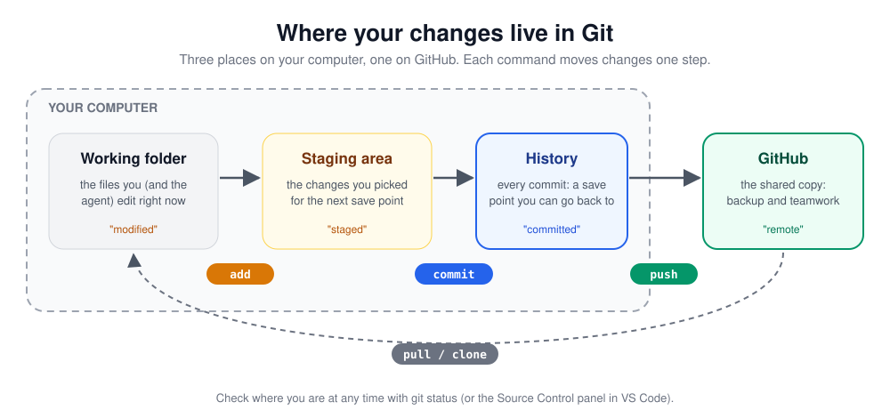
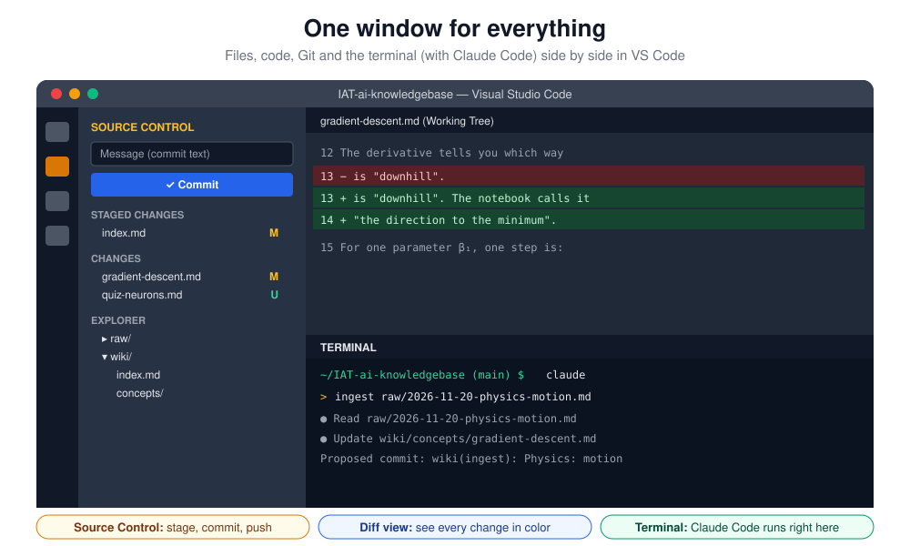

# Basics: the terminal, Git and your code editor

Three tools you will use in every session of the lab. You don't need to know everything about them. This page gives
you the parts you need, and why they matter when you work with a coding agent.

| Tool | What it is | Why you need it |
|---|---|---|
| **The terminal** | A window where you type commands instead of clicking | Claude Code runs there. So do Git and Python. |
| **Git** | A system that saves the history of your project | Every change can be seen, checked and undone, including the agent's changes. |
| **A code editor** | A program for working with code and text files | You read and check what the agent writes, and you keep everything in one place. |

They work together: you open your project in the **editor**, start **Claude Code** in the editor's **terminal**, and
use **Git** to save each step.

## 1. The terminal

The terminal (also called the *command line* or *shell*) is a text window. You type a command, press Enter, and the
computer answers. It looks old-fashioned, but it is the most direct way to control a computer, and it's where coding
agents live.

What you see before the cursor is the **prompt**. It usually shows the folder you are in:

```text
~/lab/IAT-ai-knowledgebase (main) $
```

Here `~` means your home folder, `(main)` is the Git branch, and `$` means "type here".

### Paths: where am I?

Every file has a **path**, its address in the folder tree.

| Path | Means |
|---|---|
| `wiki/index.md` | `index.md` inside the folder `wiki`, starting from where you are now (a *relative* path) |
| `/Users/anna/lab` or `C:\Users\anna\lab` | the full address from the top of the disk (an *absolute* path) |
| `.` | the folder you are in |
| `..` | the folder one level up |
| `~` | your home folder |

### The commands you need

| Command (macOS, Linux, Git Bash) | Windows PowerShell | What it does |
|---|---|---|
| `pwd` | `pwd` | Show where you are |
| `ls` | `ls` or `dir` | List the files here |
| `cd wiki` | `cd wiki` | Go into the folder `wiki` |
| `cd ..` | `cd ..` | Go one folder up |
| `mkdir notes` | `mkdir notes` | Make a new folder |
| `cat README.md` | `cat README.md` | Show what's in a file |
| `cp a.md b.md` | `cp a.md b.md` | Copy a file |
| `mv a.md wiki/` | `mv a.md wiki/` | Move or rename a file |
| `rm old.md` | `rm old.md` | Delete a file. **There is no recycle bin!** |
| `clear` | `cls` | Clear the screen |

Four tricks that save a lot of time:

- **Tab** completes file and folder names. Type `cd wi` and press Tab.
- **Arrow up** brings back your last commands.
- **Ctrl+C** stops whatever is running. It is not "copy" in the terminal!
- **Read the error message.** It usually tells you what went wrong. If you don't understand it, ask Claude Code.

> [!TIP]
> On Windows, use **Git Bash** (installed with Git) or PowerShell. On a Mac, the app is called **Terminal**. In VS
> Code, every operating system gets the same terminal at the bottom of the window (see [section 3](#3-your-code-editor)).

## 2. Git

Git saves **snapshots** of your project, called **commits**. Each commit records what changed, who changed it, when,
and why (the commit message). You can always go back to an earlier commit. It's like a "save game" for your code,
and it is used by almost every software team in the world.

**GitHub** is a website that stores a copy of your Git project online. That gives you a backup, and it lets you
work with others.



### Words you'll hear

| Word | Means |
|---|---|
| **Repository** (repo) | A project folder that Git tracks, with its whole history |
| **Commit** | One saved snapshot, with a message |
| **Branch** | A separate line of work, e.g. to try an idea without touching `main` |
| **Remote** | The copy on GitHub. Usually called `origin` |
| **Clone** | Download a repository from GitHub, with its history |
| **Push / Pull** | Send your commits to GitHub / get the new commits from GitHub |
| **Diff** | The difference between two versions: the lines that were removed and added |

### The everyday commands

```bash
git clone https://github.com/heseltime/IAT-code-lab.git   # once: get the project
git status                     # what has changed? (use it all the time)
git diff                       # show the changed lines
git add wiki/index.md          # stage one file (or: git add . for everything)
git commit -m "Add notes on photosynthesis"
git push                       # send your commits to GitHub
git pull                       # get the latest changes from GitHub
git log --oneline              # the history, one line per commit
```

**Good commit messages** say *what* changed and, if it's not obvious, *why*: "Add quiz skill" or "Fix broken link in
index". Avoid "update" or "stuff". The LLM wiki uses messages like `wiki(ingest): <title>`.

**Not everything belongs in Git.** Passwords, API keys, large datasets and personal data stay out. List files Git
should ignore in a file called `.gitignore`.

### Git and coding agents

Git is your safety net when an agent changes your files:

1. **Commit before you ask for a big change.** Then you have a save point.
2. **Read the diff** of what the agent changed before you keep it.
3. **Undo** if you don't like it: `git restore <file>` throws away the changes to a file that you haven't committed yet.
4. **Commit when it works**, with a clear message. Claude Code proposes messages. You decide.

## 3. Your code editor

Any code editor works for this lab: VS Code, PyCharm, Zed, Sublime Text, or even Vim if you like a challenge. What
matters is that it shows your whole project folder, highlights code, and lets you see changes clearly.

**We recommend [Visual Studio Code](https://code.visualstudio.com/) (VS Code).** It's free, works on Windows, macOS
and Linux, and is the most used code editor today. Two features make it the best fit for working with a coding agent:



### The integrated terminal: the main reason

VS Code has a terminal built in (**View → Terminal**, or `` Ctrl+` ``). It opens directly in your project folder. So
you can start Claude Code there, and see its changes appear in the files and in Source Control **in the same
window**, while it works. You don't need to switch between apps, and you never lose track of which folder you are in.
On Windows, macOS and Linux the terminal works the same way, so everyone in the lab sees the same thing.

There is also a [Claude Code extension for VS Code](https://docs.claude.com/en/docs/claude-code/ide-integrations)
that shows the agent's proposed edits as diffs in the editor.

### Git management in Source Control

The **Source Control** panel (the branch icon on the left, or `Ctrl+Shift+G`) does the everyday Git work with clicks:

- **See what changed:** every changed file is listed. `M` means modified, `U` means new (untracked), `D` deleted.
- **See how it changed:** click a file to open a **diff view**, with removed lines in red and added lines in green.
  This is the best way to check what an agent did.
- **Stage:** the `+` next to a file stages it. **Discard:** the arrow throws the change away.
- **Commit:** type a message at the top and click **Commit**.
- **Sync:** push and pull with one button. The status bar at the bottom shows the branch and how many commits
  you are ahead or behind.

Knowing the commands from [section 2](#2-git) still matters: the agent uses them, error messages talk about them,
and they work everywhere. Source Control is a view of the same thing.

### Other things VS Code is good at

- **Extensions** for Python and Jupyter notebooks (you need both for
  [`IAT-nns-for-students`](../IAT-nns-for-students/README.md)).
- **Markdown preview** (`Cmd+Shift+V` / `Ctrl+Shift+V`): read READMEs and wiki pages with their pictures.
- **Dev containers:** open a project in a ready-made environment where all the software is already installed
  (see the [Getting started](../README.md#getting-started) section of the lab README).

### Shortcuts worth learning

| Shortcut (Windows / Linux) | macOS | What it does |
|---|---|---|
| `Ctrl+Shift+P` | `Cmd+Shift+P` | **Command Palette**: find any command by typing its name |
| `Ctrl+P` | `Cmd+P` | Open a file by typing part of its name |
| `` Ctrl+` `` | `` Ctrl+` `` | Show or hide the terminal |
| `Ctrl+Shift+G` | `Ctrl+Shift+G` | Source Control |
| `Ctrl+Shift+E` | `Cmd+Shift+E` | Explorer (your files) |
| `Ctrl+Shift+V` | `Cmd+Shift+V` | Markdown preview |

## Putting it together: one work session

```text
1. Open the project folder in VS Code         File → Open Folder
2. Open the terminal                          Ctrl+`
3. Get the latest version                     git pull
4. Start the agent and give it a task         claude
5. Check what it changed                      Source Control → click each file
6. Keep what's good, discard what isn't       + to stage, arrow to discard
7. Save the step                              type a message → Commit
8. Share it                                   Sync (or: git push)
```

## Try it

1. In the terminal, go to the lab folder with `cd`, then into `IAT-ai-knowledgebase`. Use `pwd` and `ls` to check
   where you are. Use Tab!
2. Run `git log --oneline`. How many commits are there? Who made them?
3. Change one word in `wiki/index.md`. Run `git status` and `git diff`. Then look at the same change in VS Code's
   Source Control. Throw it away with `git restore wiki/index.md` and check that it's gone.
4. Ask Claude Code: *"Explain what git status shows me right now, in simple words."*

## Further reading

- [Pro Git](https://git-scm.com/book/en/v2), the free Git book (chapters 1 and 2 are enough to start)
- [VS Code: Source Control](https://code.visualstudio.com/docs/sourcecontrol/overview) and
  [VS Code: Terminal](https://code.visualstudio.com/docs/terminal/basics)
- [The Missing Semester of Your CS Education](https://missing.csail.mit.edu/) (MIT): the shell, Git and editors
