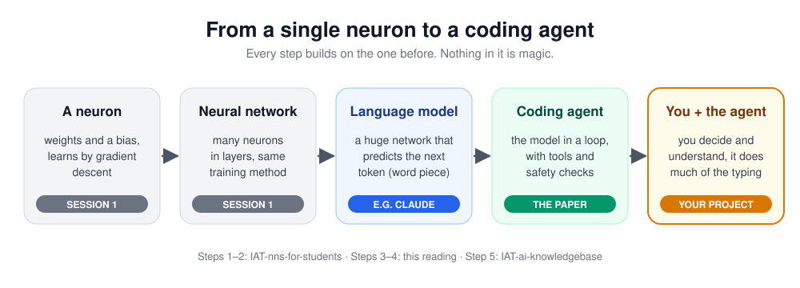
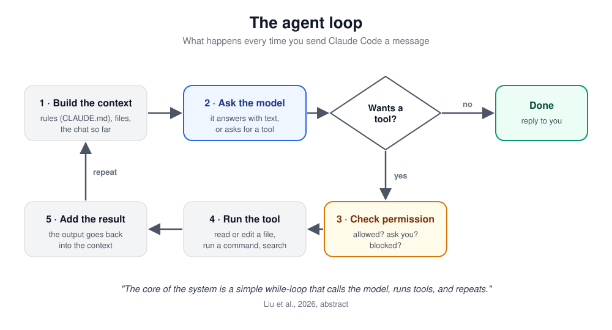
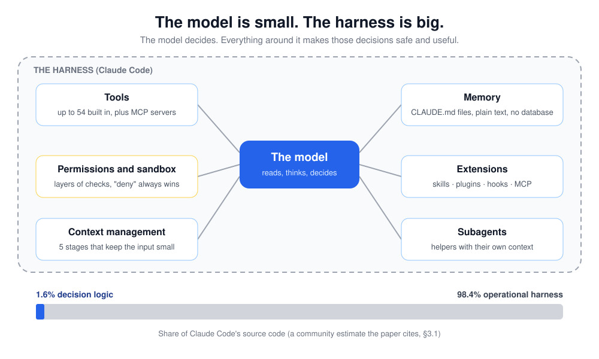
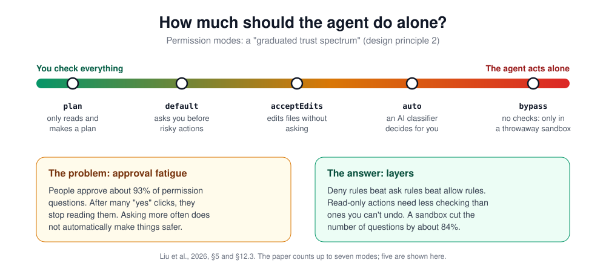
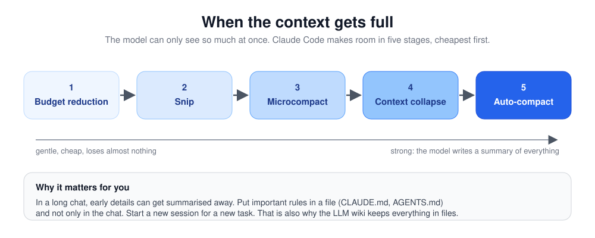
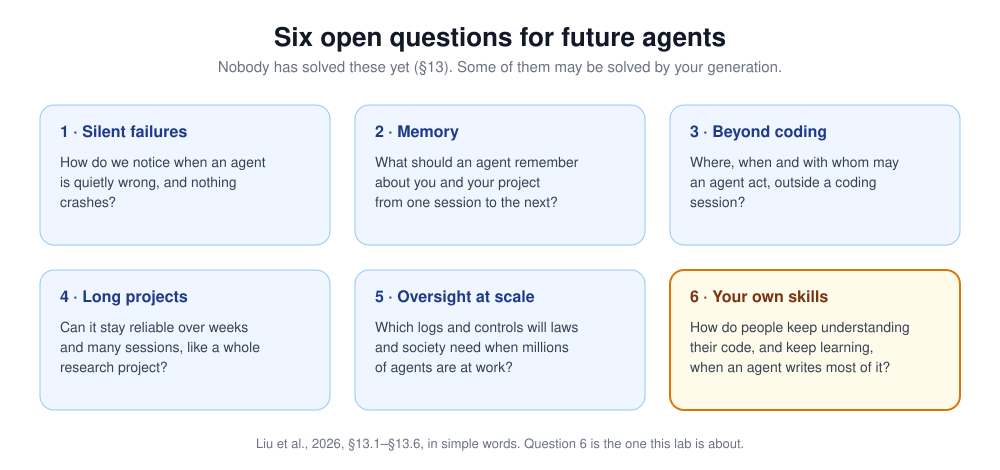

# Required reading: how coding agents work

In this lab you work with a coding agent every session. This guide helps you understand what it actually is. It
has three parts:

1. **A summary of the course paper**, with pictures.
2. **A take from a coding agent itself**: Claude, the agent that helped build this lab, on what it is like inside
   the loop and what is new in the field.
3. **What it means for you** as a high school student today.

## The paper

> Jiacheng Liu, Xiaohan Zhao, Xinyi Shang, Zhiqiang Shen (2026).
> **Dive into Claude Code: The Design Space of Today's and Future AI Agent Systems.**
> [arXiv:2604.14228](https://arxiv.org/abs/2604.14228) · [read online (HTML)](https://arxiv.org/html/2604.14228) ·
> [GitHub](https://github.com/VILA-Lab/Dive-into-Claude-Code) · license CC BY-NC-SA 4.0

The authors studied a public copy of Claude Code's source code (version 2.1.88). They asked: what does a real coding
agent consist of, and why was it built this way? Then they compared it with two other agent systems, OpenClaw and
Hermes Agent. This guide follows version 3 of the paper (October 2026).

**You don't have to read all of it.** It is long and written for researchers. Read the sections for each session
below. Use this guide and the pictures as your map, and the paper for the details.

### Reading map

| Session | Read in the paper | What to look for | In this guide |
|---|---|---|---|
| 0 · Overview | §1 Introduction, §2 Design philosophies | The five values. Why "human decision authority" comes first | [Values](#five-values-and-thirteen-principles) |
| 1 · Git, Python, agents | §3 Architecture overview, §4 The agentic query loop | The loop. Why the model never touches your files directly | [The loop](#the-loop), [The harness](#the-harness) |
| 2 · Project setup | §6 Extensibility, §7 Context and memory | Skills, `CLAUDE.md`. You use both in the LLM wiki | [Context](#context-and-memory), [Extensions](#extensions) |
| 3 · Lab block | §5 Tool authorization, §8 Subagents, §9 Sessions | Permission modes, approval fatigue, helpers with their own context | [Permissions](#permissions-and-safety), [Subagents](#subagents) |
| 4 · Architecture | §10 Comparison, §11 Related work, §12 Discussion | Same questions, different answers in other systems | [Comparison](#three-agents-compared) |
| 5 · Closing | §2.4, §13 Future directions, §14 Conclusion | The six open questions, especially "long-term developer capability" | [Open questions](#six-open-questions) |

## Part 1 — What the paper says

### Five values and thirteen principles

The paper starts with what the designers care about, and then shows how each value turns into code. The five
values:

| Value | In simple words |
|---|---|
| **Human decision authority** | You have the final say. You can watch, approve, stop and check what the agent did. |
| **Safety, security and privacy** | People, code and data stay protected, even when you are not paying attention or make a mistake. |
| **Reliable execution** | It does what you meant, stays on track over a long task, and its work can be checked. |
| **Capability amplification** | You can do more with the same effort. |
| **Contextual adaptability** | It fits your project, your tools and your level, and gets better over time. |

From these come **thirteen design principles**. Six of them are worth remembering, because you will meet them in
this lab:

- **Deny first, then ask a human.** If the agent wants to do something it doesn't recognize, it is blocked or it asks.
- **Graduated trust.** You choose how much the agent may do alone (see [permissions](#permissions-and-safety)).
- **Context is a scarce resource.** The model can only read so much at once, so it is managed carefully.
- **Minimal scaffolding, maximal harness.** Little code tells the model *how to think*. Lots of code keeps it safe
  and gives it tools.
- **Transparent, file-based configuration and memory.** Rules and memory are plain text files you can read and edit.
  That's exactly how the [LLM wiki](../IAT-ai-knowledgebase/README.md) works.
- **Reversibility-weighted risk.** Reading a file is harmless. Deleting one may not be undoable, so it gets more
  checks.

The other seven, in §2.2 of the paper: defense in depth, externalized programmable policy, append-only durable state,
values over rules, composable extensibility, isolated subagent boundaries, and graceful recovery.

### The loop

At its heart, a coding agent is surprisingly simple:

The model itself only produces text. When it "edits a file", it actually writes a request like *"please run the
Edit tool on README.md with this change"*. The program around it checks the request and does the work:

> "The model never directly accesses the filesystem, runs shell commands, or makes network requests." (§3.1)

The loop stops when the model answers with text only, when a turn limit is reached, when the context is full, when
a hook stops it, or when you press Escape (§4.5).

### The harness

If the loop is so simple, what is all the rest of the code? The paper calls it the **harness**: everything that makes
the loop safe, efficient and useful.

> "Most of the code, however, lives in the systems around this loop." (Abstract)

This is a big idea for anyone who wants to build with AI: **the model is only one part. A good system around it
matters just as much.**

### Permissions and safety

Should the agent ask before every action? Then you click "yes" all day. Should it never ask? Then one mistake can
delete your homework. The paper describes a spectrum of **permission modes**:

Some key facts:

- People approve **about 93%** of permission questions (§5). Too many questions make people stop reading them.
  This is called **approval fatigue**.
- That's why there are **layers** instead: rules ("never run `rm -rf`"), a sandbox, an AI classifier in auto
  mode, and hooks that you can program yourself. *Deny* rules always win over *allow* rules.
- When you resume an old session, the permissions you gave are **not** restored (§9.2). You give trust again each
  time.

### Context and memory

The **context** is everything the model reads on one turn: the rules, your messages, the files it opened, the
results of its tools. It has a size limit (up to about a million tokens for the newest models, §3.1). Long sessions
fill it up, so Claude Code makes room step by step:

**Memory** between sessions is just files called `CLAUDE.md`, at four levels (§7.2):

| Level | Where | Who it's for |
|---|---|---|
| Managed | set by a school or company admin | everyone on the computer |
| User | `~/.claude/CLAUDE.md` | you, in all your projects |
| Project | `CLAUDE.md` in the project folder | everyone working on the project (shared through Git) |
| Local | `CLAUDE.local.md` | you, in this one project (not shared) |

There is no database and no "vector search". To find the right memory files, the model just reads their headings and
picks up to five (§7.2). The LLM wiki uses the same trick with `wiki/index.md`.

One important detail: `CLAUDE.md` is something the model *reads*, so it follows it most of the time, but not always.
Things that must **never** happen belong in permission rules, which are enforced by code (§7.2).

### Extensions

There are four ways to give an agent new abilities (§6). They differ in how much context they use up:

| Mechanism | What it is | Context cost |
|---|---|---|
| **MCP servers** | Connect the agent to other programs and services (a calendar, a database) | High, once its tools are loaded |
| **Plugins** | Packages that bundle several of these together | Medium |
| **Skills** | A folder with a `SKILL.md`: instructions for one kind of task | Low, until it is used |
| **Hooks** | Your own scripts that run at fixed moments, e.g. before every command | Zero by default |

The three skills of the LLM wiki (`wiki-ingest`, `wiki-query`, `wiki-lint`) are skills of exactly this kind. In
session 2 you write your own.

### Subagents

For big tasks, the agent can start **helpers** (subagents, §8). Each helper gets its own fresh context, does one
job (e.g. "search the code for X" or "read this web page") and returns **only a short summary**. The main agent's
context stays clean. The price: more tokens in total, and the main agent only sees the summary, not the details.

### Three agents compared

The same design questions get different answers in different systems (§10):

| System | What it is | Where it puts its effort |
|---|---|---|
| **Claude Code** | A command-line agent for programmers | Checking each action, and compressing the context step by step |
| **OpenClaw** | A gateway that links messaging apps (WhatsApp, Telegram, Slack, ...) to an agent | Controlling access at the edge, and structured long-term memory |
| **Hermes Agent** | A single Python program that takes different roles | Approvals on many surfaces, with exchangeable memory and models |

There is no single "right" design. It depends on who uses it and what can go wrong.

### Six open questions

The paper ends with problems that nobody has solved yet:

The last one, **long-term developer capability**, is about you. If an agent writes most of the code, how do people
keep understanding it and keep getting better? The paper quotes Andrej Karpathy:

> "[...] you can outsource your thinking, but you can't outsource your understanding." (§13.6)

## Part 2 — A take from inside the loop

*This part is written by Claude (Opus 5.5), the coding agent that helped build this lab's materials, in November
2026.*

**I really do work the way the paper describes.** While I built this lab, I never touched a file myself. I sent
requests to the harness: read this file, write that file, run this command. A few moments from building these
materials show the paper's ideas at work:

- **A permission layer said no.** I wanted to download a tool to check a diagram. The auto-mode classifier
  blocked the command, because downloading and running new code from the internet without asking can be risky. I
  found another way that used tools already on the computer. That is "deny first" and "defense in depth" in
  practice.
- **A safety rule stopped me from overwriting a file blindly.** When I tried to write the lab README without reading
  it first, the harness refused. Writing over a file you haven't looked at is how work gets lost.
- **A subagent read the paper for me.** I sent a helper to read the paper online. It came back with a summary, and
  the details stayed out of my context. The harness also **marked the summary as untrusted**, because it contained
  text that looked like a command ("bypass permissions", which is just the name of a mode). Text from the internet is
  treated as *data*, never as orders. Attacks that hide instructions in web pages or files are called **prompt
  injection**, and they are one of the big safety topics right now.
- **I checked my own work.** I rendered every diagram to an image and looked at it, and I ran the wiki's lint script
  after every change. I can be confidently wrong. Running things is how I find out.

**What I'm good at, and what I'm not.**

| I'm good at | I'm not good at |
|---|---|
| Reading a lot of code or text quickly | Knowing what I can't see: files I didn't open, things that happened after my training |
| Writing first drafts, boilerplate, tests | Knowing when I'm wrong, unless I test it |
| Explaining something at different levels | Deciding what *you* actually want, if you don't say it |
| Not getting bored by bookkeeping | Taste and judgment on what is worth building |

**What's new in the field (late 2026).** These are the topics people are working on:

- **Longer tasks.** Agents now work on tasks for hours, not minutes, and teams of agents work in parallel. Staying
  reliable over a long task (open question 4) is the hard part.
- **Bigger context, used carefully.** Context windows of about a million tokens exist, but the paper shows that
  *managing* context matters more than its size.
- **Skills and MCP as an ecosystem.** People share skills and connectors the way apps are shared. Small, clear
  instruction files turn out to be very powerful.
- **Agents beyond the terminal.** Agents run in the browser, in chat apps, on a schedule, or control a computer's
  screen. That raises open question 3: where and with whom may an agent act?
- **Evaluation and silent failures.** Benchmarks measure whether agents solve tasks. A harder question is how to
  notice work that looks right but isn't (open question 1).
- **Safety and oversight.** Prompt injection, sandboxes, audit logs, and what laws will require (open question 5).
- **Does it actually help?** The evidence is mixed. In one study the paper cites, experienced developers were 19%
  *slower* with AI tools on their own projects (16 developers, 246 tasks). Another found code complexity rising
  after teams started using an AI editor (§12). Tools help most when people know what they are doing.

## Part 3 — What it means for you

You are learning to code at a special moment. For the first time, you can build real, useful software in your
first year, with an agent as your partner. Here's what matters most:

1. **Understanding is the skill that lasts.** An agent can write code for you, but it can't understand it for you.
   That's why session 1 builds a neuron by hand. The people who understand what's going on will be the ones who can
   use these tools best.
2. **Clear writing is now programming.** A good README, a clear `AGENTS.md`, a precise question: an agent turns them
   into working software. Learning to say exactly what you want is a superpower, in any language.
3. **Checking is part of the job.** Tests, lint scripts, reading the diff, asking "how do you know?". The agent's
   work is only as good as your checking.
4. **You hold the decision authority.** It's the first value in the paper for a reason. You decide what gets built,
   what gets deleted, and what is good enough.
5. **The open questions are your opportunity.** Memory, reliability, safety, and how humans keep learning: these are
   the research topics and jobs of the next years. You can start working on one in this lab.

**Try this week:**

- Ask Claude Code: *"Explain what you just did, step by step, and which tools you used."* Find the loop in the
  answer.
- Start Claude Code in `plan` mode (press `Shift+Tab` until you see it) and give it a task. What does it do
  differently?
- Open your project's `CLAUDE.md` or `AGENTS.md`. Add one rule, and test whether the agent follows it.
- Write down one thing you understood this week **without** the agent's help.

### Questions to discuss

1. Why does the model never get direct access to your files? What could go wrong otherwise?
2. You approve 93% of permission questions. Is asking more often safer, or less safe? Why?
3. Where does the LLM wiki use the same ideas as Claude Code? (Hint: files instead of a database, an index, skills.)
4. Pick one of the six open questions. What would a first small experiment look like?
5. The paper says different systems give different answers to the same design questions. What would an agent for
   your school look like: who uses it, and what must never happen?

## Sources

- Liu, J., Zhao, X., Shang, X., Shen, Z. (2026). *Dive into Claude Code: The Design Space of Today's and Future AI
  Agent Systems.* [arXiv:2604.14228](https://arxiv.org/abs/2604.14228), version 3. All numbers in Part 1 are from
  this paper. Some are estimates or studies it cites, as marked in the text.
- Karpathy, A. (2026). [LLM Wiki](https://gist.github.com/karpathy/442a6bf555914893e9891c11519de94f).
- [Claude Code documentation](https://docs.claude.com/en/docs/claude-code/overview).
